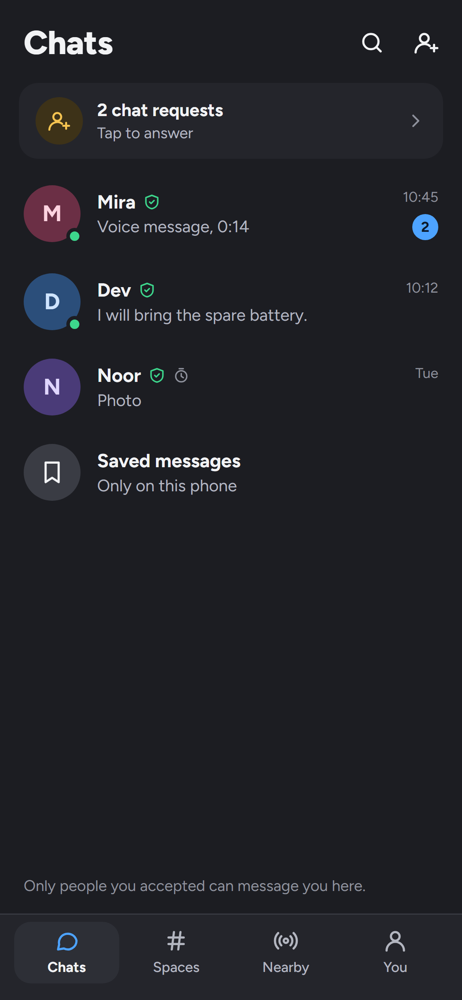
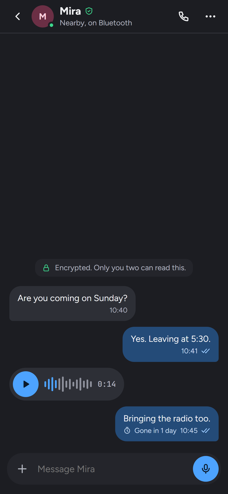
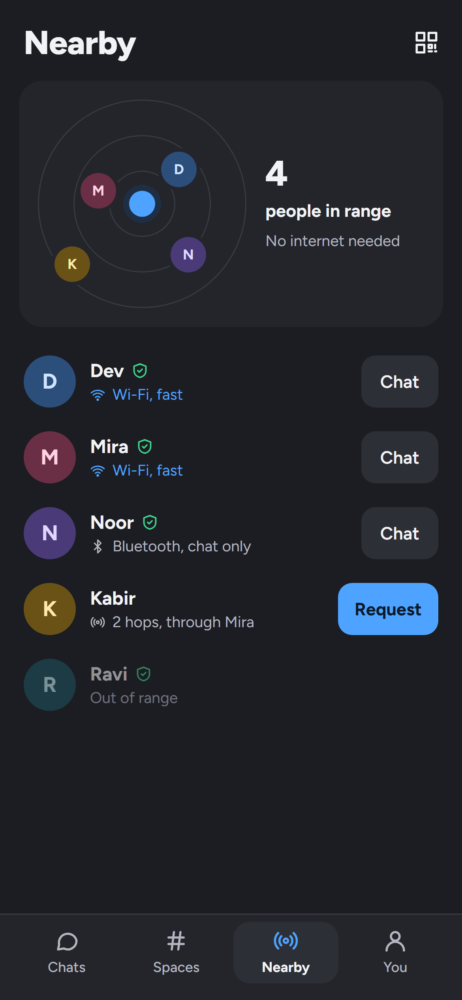
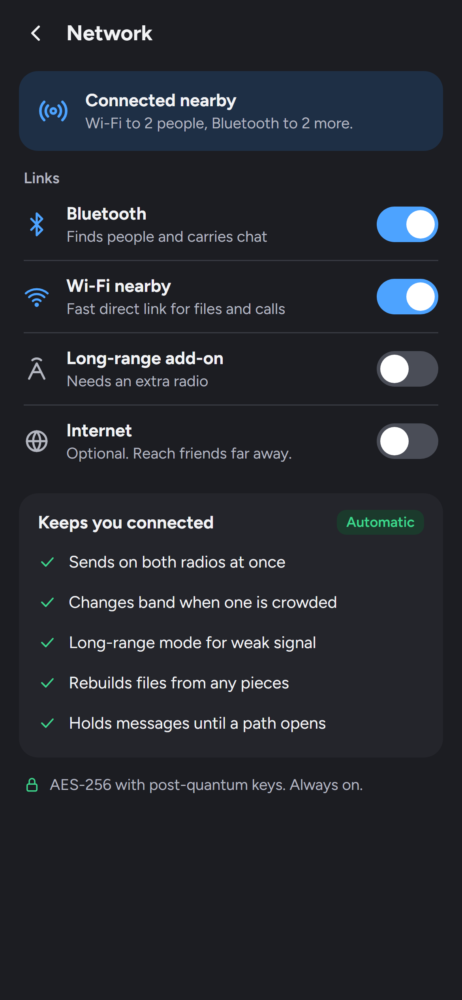

<p align="center">
  
</p>

<h1 align="center">DNet: Your Offline Connector</h1>

<p align="center">
  <b>Chat, call and share files with people nearby, with no internet.<br>
  Reach people kilometres away through a LoRa radio.</b>
</p>

<p align="center">
  Android 10+ · Windows 10/11 (x64) · End-to-end encrypted · No servers · No phone number · MIT
</p>

---

DNet is an end-to-end encrypted messenger for Android and Windows that
works with **no internet, no servers and no accounts**. Devices find each
other over Bluetooth and nearby Wi-Fi; with a small LoRa radio plugged in,
over kilometres. When the person you want is out of range, messages hop
through other DNet devices to reach them.

An identity is just a name. Everything you send is sealed to the person
it is for, and everything you keep is encrypted on your own device.

## Features

**Reach people without the internet**
- **Nearby, offline:** devices find each other over Bluetooth LE, Wi-Fi
  Direct or the same Wi-Fi network, and a message can travel through up
  to 4 other devices to get where it is going.
- **Long range:** an external LoRa radio (any Meshtastic board over USB,
  Bluetooth or Wi-Fi, or a bare module with DNet's serial firmware)
  carries chat for kilometres, through other radios in between. A
  three-step setup picks the device, the band that is legal where you
  are, and tests the link.
- **Every link at once:** chats go out on every link to a person and the
  first copy to arrive counts. Files take the fastest link and never a
  radio. Call audio comes first, then chat, then small files, then big.
- **Nearby maps:** live Bluetooth and Wi-Fi maps of the devices around
  you, their links, and the route a message would take.

**Talk**
- **Direct chats:** chat requests, disappearing messages, view-once
  photos, photos, videos, voice notes, polls, locations, contacts and
  files of any size. Files travel in pieces checked against a hash tree,
  and a transfer resumes over any link or path.
- **Spaces:** groups with a description, text channels, voice rooms,
  roles, rules (such as "No links from members"), invite links that
  expire, public channels, a space icon and ownership transfer.
- **Calls:** voice and video calls, with screen sharing in calls and
  voice rooms.
- **Writing:** Markdown, @mentions aimed at the person's key rather than
  their name, `.afk` away notes, a short tag when two people share a name
  (`Sam·4F2A`), and a warning sheet before any link opens.
- **Emoji and stickers:** all 1,923 Unicode 18 emoji with search and skin
  tones; sticker packs, favourites and stickers made from your own photos.

**Stay private**
- **Verify people:** automatically by scanning their QR code or tapping
  phones together (NFC), or by hand by comparing four words or a 12-word
  code. A new key is always a new, unverified person.
- **Privacy:** an identity needs nothing but a name; a proof-of-work stamp
  makes creating accounts in bulk costly; app lock with a passcode; you
  choose who may send you chat requests and whether to pass on messages
  for others. The app makes no network calls of its own.
- **Names you can trust the look of:** invisible and text-reversing
  characters are taken out of other people's names, so nobody can pass for
  one of your contacts by look alone.

**Made for both platforms**
- **Notifications:** messages, chat requests, mentions and incoming calls
  arrive as the device's own notifications while DNet is not in front. Tap
  one to open that chat. Hide what was said, or, with an app lock, who it
  is from too.
- **Always on:** DNet keeps finding people and taking messages in the
  background: after you leave it on Android, with a notice saying so, and
  in the system tray when you close the window on Windows. Switch it off
  and closing DNet closes it.
- On Windows the app fills the window: a resizable list beside the open
  chat, members beside a channel on wide screens, hover tips, right-click
  menus, and keyboard shortcuts (Ctrl+K find a chat, Ctrl+N new chat,
  Ctrl+1 to Ctrl+4 switch tabs, Ctrl+F search a channel, Esc to close,
  Shift+Enter for a new line).
- On Android: touch feedback, long-press menus and light haptics.
- Terms of Use to accept on first start, and an About page with the
  version, what DNet is for and links to this repository.

## Screens

| Chats | Direct message | Nearby | Network |
|---|---|---|---|
|  |  |  |  |

## Install

Download the latest build from the
[Releases](https://github.com/official-imvoiid/DNet-Your-Offline-Connector/releases)
page.

| Platform | File | How |
|---|---|---|
| Android 10 or later | `DNet-Android.apk` | Open it on the phone, allow installs from that app when asked, then Install. |
| Windows 10/11, 64-bit | `DNet-Windows` folder | Keep the folder together and run `dnet.exe`. Nothing else needs installing. If Windows shows "Windows protected your PC", choose **More info → Run anyway**. |

On first start, read and accept the Terms of Use, then create your
identity with just a name.

## Build from source

**Tools:** Flutter 3.47.7 (Dart 3.13.5), Rust stable, JDK 17, Android SDK
(platform 36, build-tools 36.0.0, NDK 28.2), and Visual Studio 2022 Build
Tools on Windows.

```bash
rustup target add aarch64-linux-android armv7-linux-androideabi x86_64-linux-android
flutter config --android-sdk <path> --jdk-dir <path to JDK 17>
```

**On Windows, one step:**

```bat
build.cmd
```

It empties `dist/` and builds both apps straight into it:

```
dist/
├── DNet-Android.apk
└── DNet-Windows/
    └── dnet.exe   (plus the libraries it needs; keep the folder together)
```

**Or each on its own**, from `app/`:

```bash
flutter pub get
flutter build apk --release        # writes dist/DNet-Android.apk
flutter build windows --release    # writes dist/DNet-Windows/
```

Building the app also builds the Rust core (for three Android processor
types, so the first Android build is slow) and, on Windows, the radio
library. The Windows folder carries the Visual C++ runtime, so it runs on
a PC that has never had it installed.

**Signing:** a release APK is signed with the keystore named in
`app/android/key.properties` (`storeFile`, `storePassword`, `keyAlias`,
`keyPassword`). Keep that file and the keystore out of git; `.gitignore`
already does. Without it the build signs with the debug key and says so.

## Architecture

```
Screens and widgets (Flutter)
   └─ AppState: one source per kind of thing
        ├─ Store, Directory, SpaceBook, calls  ──FFI (JSON)──►  Rust core
        └─ LinkPump: one priority queue per link       identity, envelopes,
             └─ Radio: Bluetooth · local Wi-Fi ·       vault, chat, spaces,
                       Wi-Fi Direct · LoRa             files, mesh relay
```

| Folder | What it holds |
|---|---|
| [`app/`](app/) | The Flutter app (Dart) for Android and Windows: screens, data layer, radio glue, calls, the LoRa drivers and protocol |
| [`core/`](core/) | The Rust core: identity, encryption, the encrypted vault, chats, spaces, calls, files and mesh routing. The app loads it over FFI. |
| [`radio_windows/`](radio_windows/) | Rust library for Windows: Bluetooth LE, Wi-Fi Direct, the camera, the microphone and speaker, and screen capture |
| [`docs/`](docs/) | The LoRa radio guide and the hardware shopping list |
| [`design/`](design/) | The design kit: spec, screen images and their HTML references |
| [`tool/`](tool/) | Python generators for icons, emoji data and the built-in stickers |

On Android, the radios, USB, camera, NFC and screen capture are Kotlin
code in `app/android/app/src/main/kotlin/`. [ARCHITECTURE.md](ARCHITECTURE.md)
has the full map: every folder, every layer and what each one trusts.

## Transports

| Transport | Finds people | Carries | Speed | Range |
|---|---|---|---|---|
| Bluetooth LE | yes | chat, files (slowly) | ~10 KB/s | ~10–50 m |
| Local Wi-Fi (same network) | yes | everything, calls | MB/s | the network |
| Wi-Fi Direct | made on demand for a big file or a call | everything | MB/s | ~50 m |
| LoRa radio | yes | chat only | ~100 B/s | 1–10 km, more through other radios |
| Mesh relay | through any of the above | sealed envelopes | | up to 4 hops |

## Long-range radio, in short

1. Buy a Meshtastic board for your band and **attach its antenna before
   powering it** ([docs/HARDWARE.md](docs/HARDWARE.md) has boards and
   prices). In India, buy the 868 MHz version (it covers 865–867 MHz).
2. In DNet: **You → Network → Long-range add-on**. Step 1, the device (USB;
   Bluetooth on Android; or Wi-Fi by address). Step 2, the band that is
   legal where you are. Step 3, **Say hello on the air** to test the link.
3. Switch **Long-range** on under **Links**. The Link card shows the
   signal, the round-trip time and the airtime used; each message sent by
   radio shows sent, relayed, delivered or failed.

The full guide, limits and troubleshooting are in [docs/RADIO.md](docs/RADIO.md).

## Security model

Cryptography lives only in the Rust core and uses reviewed libraries:
Ed25519 signatures, X-Wing HPKE (ML-KEM-768 plus X25519) to seal messages,
AES-256-GCM and HKDF, Argon2 for the app lock, and a `redb` database
encrypted at rest. No primitive is written by hand.

- Every message is sealed to its recipient, with the sender's signature
  inside. Devices that pass messages on cannot open them.
- Every link starts with each side signing the other's fresh number, so an
  identity cannot be borrowed. The radios' own encryption is never relied
  on.
- Replays are dropped at the link, chat, call-media and LoRa layers.
- Everything read from a radio is size-limited before it is used, and
  floods are rate-limited: passing on for others, new LoRa links, and
  local connections that never introduce themselves.

The security model, its known limits, every review finding and how to
report a problem privately are in [SECURITY.md](SECURITY.md).

## Documents

| File | What it is |
|---|---|
| [TERMS.md](TERMS.md) | Terms of Use and Disclaimer, the same text the app asks you to accept |
| [SECURITY.md](SECURITY.md) | Security model, known limits, review findings, reporting |
| [ARCHITECTURE.md](ARCHITECTURE.md) | How the code fits together |
| [CHANGELOG.md](CHANGELOG.md) | What changed in each version |
| [CONTRIBUTING.md](CONTRIBUTING.md) | Setting up, the rules the code follows, sending a change |
| [docs/RADIO.md](docs/RADIO.md) | The long-range radio guide |
| [docs/HARDWARE.md](docs/HARDWARE.md) | Which LoRa boards, antennas and cables to buy |

## Contributing

Bug reports, ideas and pull requests are welcome. Read
[CONTRIBUTING.md](CONTRIBUTING.md) first. To report a security problem,
follow [SECURITY.md](SECURITY.md) rather than opening a public issue.

## License

[MIT](LICENSE) © The DNet authors. The bundled fonts (Figtree, JetBrains
Mono and Noto Color Emoji) are under the SIL Open Font License; their
licence files are in `app/assets/fonts/`.

Using DNet means accepting its [Terms of Use](TERMS.md). You alone are
responsible for using it lawfully where you are, including the radio band
and power you transmit on.
